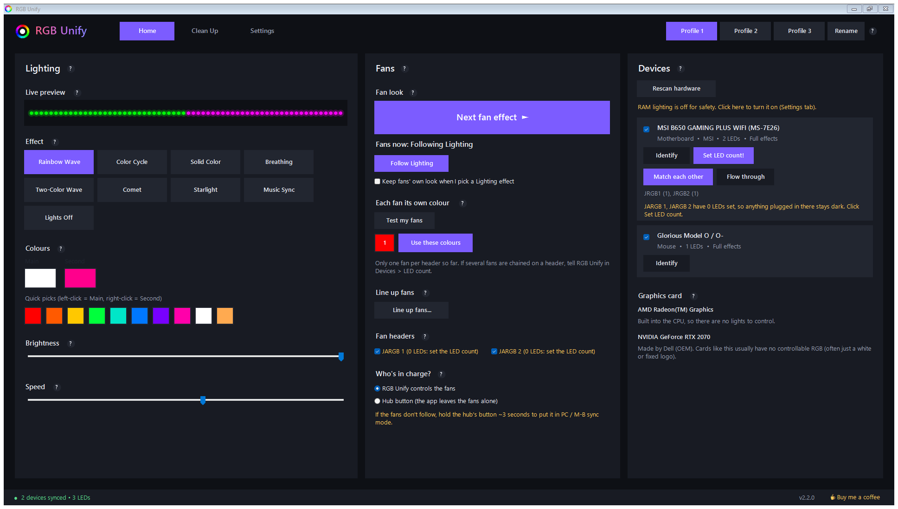
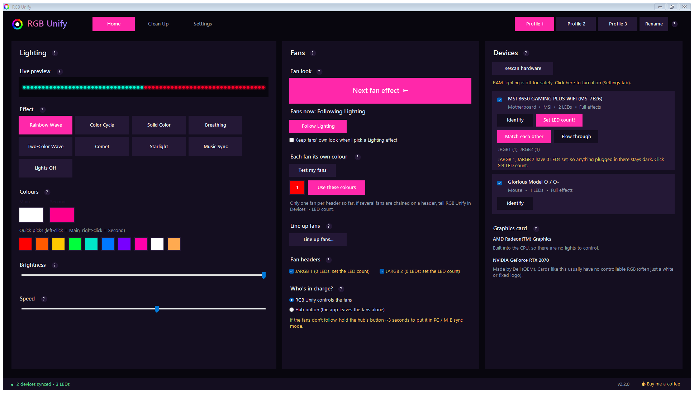
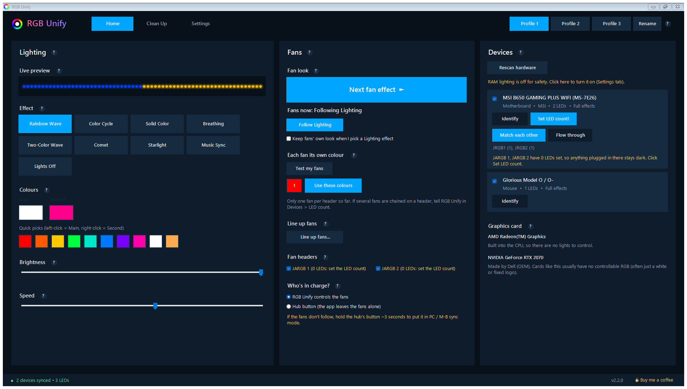
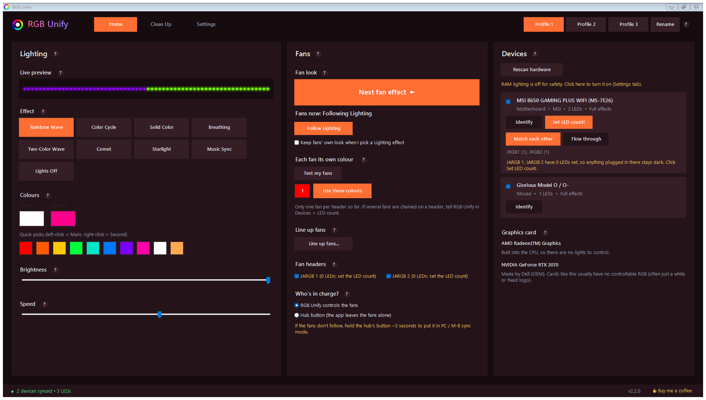
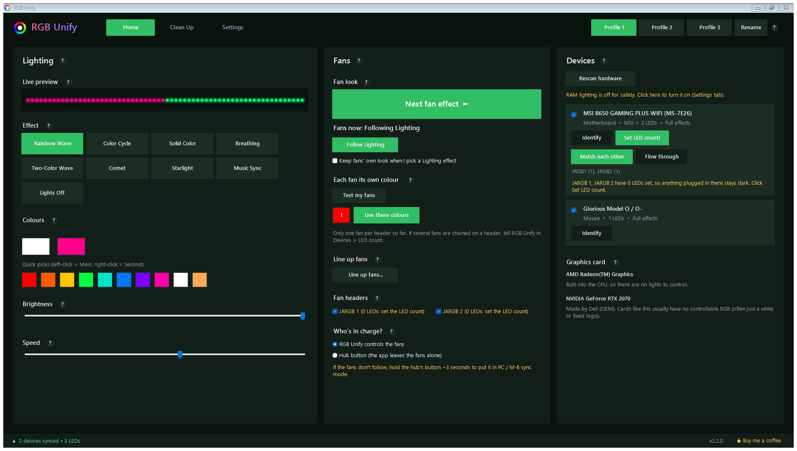
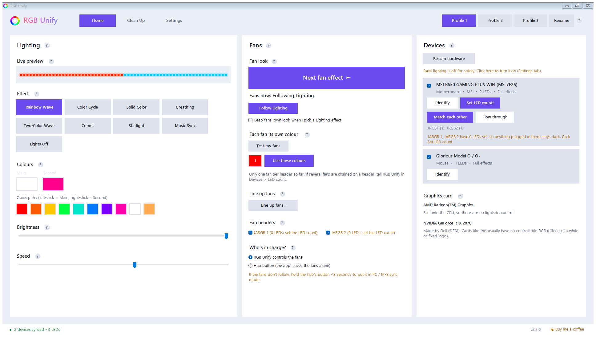
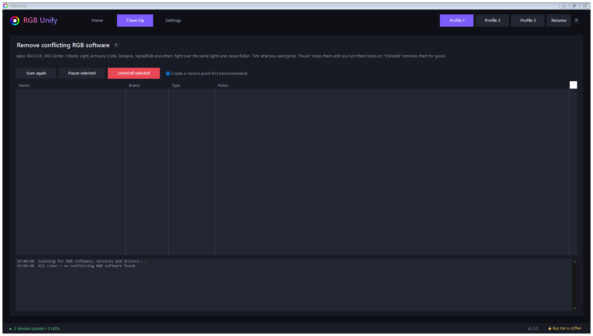
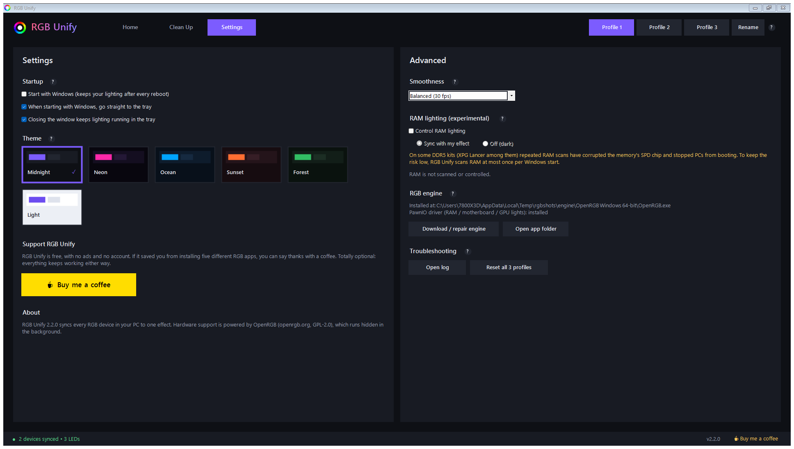
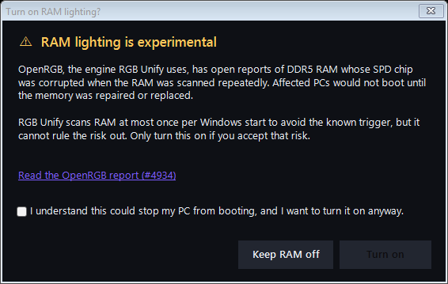

# RGB Unify

[](../../releases/latest)
[](../../actions/workflows/build.yml)
[](LICENSE)

**One simple app for all the RGB lighting in your Windows PC.** RGB Unify finds your motherboard, fans, LED strips,
graphics card, keyboard, mouse and (optionally) RAM, and syncs them all to one effect. It can also remove the
vendor RGB apps that fight over the same lights.



## Download

Grab **`RGBUnify-Setup.exe`** from the [latest release](../../releases/latest) and run it.
All versions are on the [Releases page](../../releases) (see [Versions](#versions) below).

Windows SmartScreen may warn that the app isn't signed: click **More info → Run anyway**.
Every release installer is built by [GitHub Actions](../../actions/workflows/build.yml) straight from this source code,
and its SHA-256 is attached next to it, so you can check the download matches the code.

## Screenshots

| Neon | Ocean | Sunset |
|---|---|---|
|  |  |  |
| **Forest** | **Light** | **Clean Up** |
|  |  |  |
| **Settings** | **RAM safety check** | |
|  |  | |

## How to use

### 1. Install
1. Download **`RGBUnify-Setup.exe`** from the [latest release](../../releases/latest) and run it.
2. Accept the agreement, keep the default folder, and leave **all options ticked**. That downloads the RGB engine and
   installs the **PawnIO** driver that motherboard and graphics card lights need.
3. Tick **Launch RGB Unify now** and click Finish. The window opens full screen.

> **Tip:** close or uninstall other RGB apps first (iCUE, MSI Center, Armoury Crate, SignalRGB...). Two apps
> controlling the same lights makes them flicker. The **Clean Up** tab can do this for you.

### 2. Check your devices (Home → Devices)
- After a few seconds, everything RGB Unify found is listed. Click **Identify** to flash a device white.
- **Fans or strips on the motherboard's ARGB headers (JARGB / ADD_GEN2...):** click **LED count**, then enter
  **Fans × LEDs per fan** for each header (e.g. 3 fans × 8 LEDs). Headers can't detect this themselves, and they stay
  dark until it's set.
- Two headers? Choose **Match each other** (same effect on both) or **Flow through** (one long strip).
- Untick a device to leave it alone.

### 3. Pick your lighting (Home → Lighting)
- Click an **effect**, pick the **Main** and **Second** colours (or a quick pick: left-click = Main,
  right-click = Second), then set **Brightness** and **Speed**.
- Everything is saved into the **profile** that's lit up at the top. Click **Profile 1 / 2 / 3** to switch, and
  **Rename** (or right-click a profile) to give it a name. You can also switch profiles from the tray icon.

### 4. Fans (Home → Fans), optional
- **Next fan effect** works like the button on a fan hub. **Follow Lighting** puts the fans back on the main effect.
- **Each fan its own colour:** click the numbered swatches. Click **Test my fans** first: if every fan turns red,
  your hub copies one signal to all fans, and per-fan colours aren't possible with it.
- **Line up fans:** each fan shows a white "start" light. Turn each fan with ◄ / ► until the white light is at the
  top, and tick **Flip** if one runs the other way.
- **Who's in charge?** Choose **RGB Unify** (put your hub in PC / M-B sync mode, usually by holding its button for
  ~3 s) or **Hub button** (the app leaves the fans alone).

#### Using a fan hub
Most ARGB fan hubs with a button or remote (for example the
[upHere P12PARGBBK](https://www.amazon.ca/dp/B0DWMRLQJQ)) work with RGB Unify through motherboard sync:

1. Plug the hub's **ARGB sync cable** (5V, 3-pin) into a motherboard ARGB header (JARGB on MSI, ADD_GEN2 on ASUS...).
2. Switch the hub to **M/B Sync**: press **M/B Sync** on the remote, or hold the hub's button for ~3 seconds.
   Now the hub follows your PC instead of its own effects.
3. In RGB Unify: **Devices → LED count** for that header → **1 fan × the LEDs in one fan**.

**Can each fan be a different colour?** On most hubs, **no**. They have one input and copy the same signal to every
port, so all their fans always show the same thing, in any app. That's the hardware, not RGB Unify. **Test my fans**
shows which kind you have: if every fan turns red, it's a copying hub. Fans plugged straight into the motherboard's
*other* ARGB header form a separate group. USB-controlled hubs (Corsair Commander / Lighting Node, Lian Li Uni Hub,
NZXT RGB & Fan Controller...) are different: most show up in **Devices** on their own, with a channel per port.

**Fan speed:** RGB Unify only controls lighting. Plug the hub's **PWM cable** into a motherboard fan header
(CPU_FAN / SYS_FAN), set that header to **PWM** in the BIOS (MSI boards often default to DC), and the BIOS
(or a tool like FanControl) sets the speed of every fan on the hub.

### 5. Settings
- **Settings tab:** start with Windows, the tray, **6 themes** and Buy Me a Coffee.
- **Advanced:** smoothness, **RAM lighting** (off by default, see [RAM safety](#ram-safety)), engine repair, the log.

Stuck? Hover any **?** in the app for help, or open an [issue](../../issues) and attach the log
(Settings → Advanced → **Open log**).

## Features

- **Whole-PC effects:** Rainbow Wave, Color Cycle, Solid, Breathing, Two-Color Wave, Comet, Starlight, Music Sync, Off.
  Effects flow across every device as if they were one strip.
- **3 profiles:** switch from the window or the tray icon, rename them.
- **Fans:** give fans their own look with a hub-style "Next fan effect" button, set **each fan its own colour**,
  **line up fans** mounted at different angles, and choose whether RGB Unify or your hub's button is in charge.
- **ARGB headers:** set "fans × LEDs per fan"; make JARGB 1 and 2 **match each other** or **flow through** as one strip.
- **Clean Up:** finds about 28 brands of RGB software, services and drivers (iCUE, MSI Center, Armoury Crate, SignalRGB...)
  and pauses or uninstalls them, with an optional restore point. Like Revo Uninstaller, it then removes the **leftovers**
  (folders go to the Recycle Bin, registry keys are backed up first, plus scheduled tasks and broken uninstall entries).
- **Armoury Crate, fully:** also removes its Microsoft Store version and, on ASUS boards, can stop the BIOS from
  reinstalling it (WPBT). The ASUS drivers laptops need for Fn keys and keyboard light are never touched.
- **Gaming laptops:** keyboards, light bars and logos on supported ASUS TUF / ROG, Lenovo Legion, MSI, HP OMEN, Acer Nitro,
  Gigabyte Aorus, Clevo-based and Razer Blade laptops. Single-colour keyboards use their own built-in rainbow / breathing.
  If yours isn't found, the app says why and what to do.
- **Graphics card check:** tells you if your GPU's lights were found, and why not if they weren't.
- **6 themes:** Midnight, Neon, Ocean, Sunset, Forest, Light. Opens full screen. A "?" next to every section explains it.
- Starts with Windows (in the tray) without UAC prompts.
- **Light on resources:** in the tray it uses about 14 MB RAM and ~0.01% CPU (plus ~31 MB for the OpenRGB engine), and runs at below-normal priority so games always come first.

## How it works

RGB Unify is a Windows Forms app (C#, .NET Framework 4.8, no extra runtime). Hardware access is done by
[OpenRGB](https://openrgb.org) (GPL-2.0), which RGB Unify downloads and runs hidden in the background, then drives
through OpenRGB's SDK network protocol. Motherboard, GPU and RAM lighting need the signed
[PawnIO](https://pawnio.eu) driver, which RGB Unify offers to install.

### RAM safety

On some DDR5 kits, repeated RAM scans by OpenRGB have corrupted the memory's SPD chip and stopped PCs from booting
([OpenRGB #4934](https://gitlab.com/CalcProgrammer1/OpenRGB/-/work_items/4934)). So RAM control is **off by default**.
When turned on, RAM is scanned **at most once per Windows boot**. All of OpenRGB's RAM detectors are switched off for
every other engine start.

## Building from source

No SDK needed. The C# compiler that ships with Windows is enough.

```
cd src
build.bat
```

This produces `RGBUnify-Setup.exe` (the installer, with the app embedded) in the folder above `src`.
The code sticks to C# 5 syntax so the built-in `csc.exe` can compile it.

| File | What it does |
|---|---|
| `Program.cs` | Single instance, `--tray` start, show/exit signals |
| `MainForm*.cs` | The window: Home (Lighting, Fans, Devices), Clean Up, Settings, tray |
| `Engine.cs` | Runs OpenRGB, render loop, zones and fans, RAM safety gate |
| `OpenRgbClient.cs` | OpenRGB SDK client (protocol v4) |
| `Effects.cs` | The effects and the Music Sync audio meter |
| `Conflicts.cs` | Clean Up scanner and remover |
| `Settings.cs` | Settings, profiles, startup task |
| `Theme.cs` | Colour themes |
| `Setup.cs` | Installer and uninstaller |

## Support

RGB Unify is free. If it helped you, you can [buy me a coffee](https://buymeacoffee.com/banana16x) ☕

## Versions

| Version | Highlights |
|---|---|
| [**2.4.0**](../../releases/tag/v2.4.0) | Gaming laptop keyboards & light bars, Revo-style leftover cleaning, full Armoury Crate removal (Store app + BIOS reinstall) |
| [2.3.0](../../releases/tag/v2.3.0) | Much lighter in the background: ~14 MB RAM and ~0.01% CPU in the tray, below-normal priority so games come first |
| [2.2.0](../../releases/tag/v2.2.0) | Installer builds on GitHub Actions; uninstalling offers to remove the PawnIO driver if Setup installed it; stronger RAM confirmation |
| [2.1.0](../../releases/tag/v2.1.0) | First public release: 3 profiles, 6 themes, fan tools, Clean Up, GPU check |

Every version, with its installer: [Releases](../../releases).

## Contributing

**I'll consider all edits.** Bug reports, ideas and pull requests are all welcome:

- **Found a bug or a device that isn't detected?** Open an [issue](../../issues) and attach the log
  (Settings → Advanced → **Open log**).
- **Want to change something?** Fork the repo, make your edit, and open a [pull request](../../pulls).
  Every pull request is built automatically, so you can download and test the result.
- Please keep the code compiling with `src\build.bat` (C# 5 syntax, no extra tools).

## Forks & credits

**You're welcome to fork RGB Unify, change it and share your version.** All I ask is that you **keep the credits**:

- Keep the [`NOTICE`](NOTICE) file and the copyright line in `src/VersionInfo.cs`.
- Say in your README (and in your app's About text, if it has one) that your version is
  **based on RGB Unify by [Banana16x](https://github.com/Banana16x)**, with a link to
  https://github.com/Banana16x/RGBUnify.
- Don't present a fork as the original RGB Unify. Give it a new name if it's substantially different.

The [GPL-3.0](LICENSE) also requires forks to stay open source under the same licence and to keep the original
copyright notices.

## License

[GPL-3.0](LICENSE). Copyright © 2026 Banana16x. OpenRGB and PawnIO are separate programs with their own licences.
